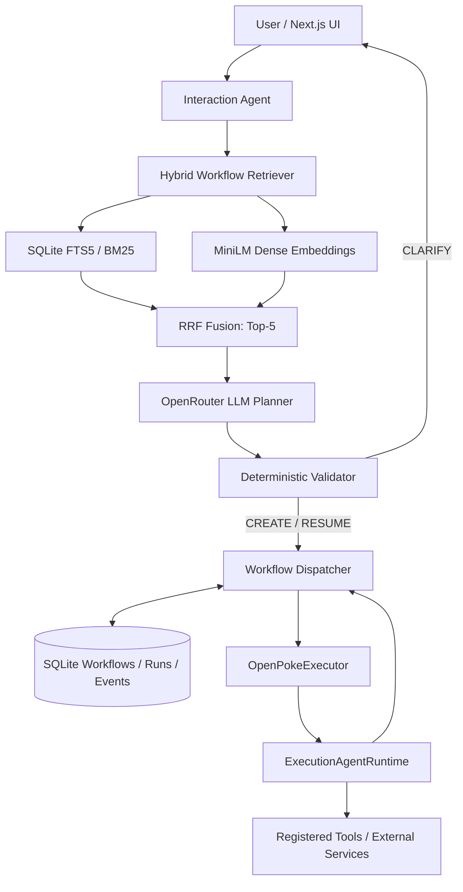

# OpenPoke — Workflow-Centric Agent Orchestration

**Persist the Work, Not the Worker.**

An extension of [OpenPoke](https://github.com/shlokkhemani/OpenPoke) that addresses **Agent Overload** by separating durable task identity from agent execution. Instead of routing every request against an ever-growing roster of persistent agents, it retrieves a small set of relevant **persistent workflows**, uses an LLM to decide whether to **CREATE**, **RESUME**, or **CLARIFY**, validates that decision, and dispatches the work to OpenPoke's existing execution runtime.

This repository includes a **Next.js chat UI**, a **FastAPI backend**, **SQLite-backed workflow persistence**, **hybrid retrieval**, **LLM planning**, and **live execution through registered OpenPoke tools**. A separate simulation mode supports testing without external side effects.

## Results at a glance

| Metric | V2 result |
|---|---:|
| Workflow corpus / evaluated routing requests | 200 / 160 |
| **LLM Planner + Validator routing accuracy** | **98.75% (158/160)** |
| Rule-based resolver accuracy | 46.88% (75/160) |
| Correct workflow resume rate | 98.53% (67/68) |
| Incorrect resume decisions | 1 / 160 |
| **Routing-section size reduction (Full Roster → Top-5)** | **88.52%** |
| Hybrid retrieval latency (P50) | 25.9 ms |
| LLM Planner latency (P50, excluding retrieval) | 1.36 s |

> **Evaluation scope:** These are results from a synthetic, annotated V2 benchmark. The final prompt was refined using previously inspected holdout errors, so **98.75% is an iteration result on the same evaluation set, not a fresh blind-test estimate**. The 88.52% figure is a reduction in **routing-section characters**, not total API tokens or billing cost. Live UI execution is a separate integration path from the routing benchmark.

## Why this project?

OpenPoke originally assigns long-lived identities and histories to execution agents. This makes task continuity possible, but introduces several scaling and routing problems as agents accumulate:

- **Growing routing context:** The Interaction Agent sees an increasingly large agent roster.
- **Ambiguous identity:** Similar agents or tasks may share contacts, projects, and business terminology.
- **Tight coupling:** Task state and execution-agent identity are treated as the same long-lived object.

**The design change:** persist each *workflow* as the durable unit of work, and instantiate an *execution runtime* when the workflow needs to run. A stable workflow ID survives across runs; the runtime itself does not need to be a permanently running worker.

## Architecture



### Routing semantics

| Action | Meaning |
|---|---|
| **CREATE** | Start a new *internal OpenPoke workflow* for an independent task or previously untracked external activity. |
| **RESUME** | Continue exactly one existing internal workflow with matching task identity, business object, and scope. |
| **CLARIFY** | Ask for more information when multiple workflows remain plausible, an explicit internal workflow UUID cannot be found, or the task is insufficiently specified. |

**Internal vs. external identity matters.** An existing external order or contract does not imply an OpenPoke workflow already exists. Conversely, a request to reopen a **specific missing internal UUID** must not silently create a replacement workflow.

### Key components

| Component | Responsibility |
|---|---|
| `server/workflows/store.py` | SQLite workflow registry, event history, run lifecycle, isolation, and persistence. |
| `server/workflows/dense.py` | MiniLM sentence embeddings and embedding cache. |
| `server/workflows/hybrid.py` | BM25 + dense retrieval with Reciprocal Rank Fusion. |
| `server/workflows/llm_planner.py` | LLM proposal for CREATE / RESUME / CLARIFY. |
| `server/workflows/planner_validator.py` | Deterministic checks on candidate membership, ownership, status, and explicit constraints. |
| `server/workflows/dispatcher.py` | Workflow creation/continuation, run tracking, and execution result persistence. |
| `server/workflows/openpoke_executor.py` | Adapter from workflow identity to the native OpenPoke execution runtime. |
| `server/workflows/bridge.py`, `demo.py` | Integration with UI modes and simulation/live execution paths. |
| `server/agents/interaction_agent/` | Chat orchestration and workflow tool selection. |
| `server/agents/execution_agent/` | Multi-turn LLM tool execution and native tool registry. |
| `evaluation/` | Reproducible V2 routing, context, and regression evaluations. |

The execution adapter uses a stable name derived from the workflow UUID (for example, `workflow-<uuid>`) when creating a fresh `ExecutionAgentRuntime`. This lets the system reuse workflow-scoped historical context without keeping an agent process alive indefinitely.

## Quick start (local)

### Prerequisites

- Python **3.10+** and `pip` (a Conda environment is also supported)
- Node.js **18+** and npm **9+**
- SQLite with FTS5 enabled (included in most standard Python builds)
- An [OpenRouter](https://openrouter.ai/) API key for LLM calls
- Internet access for OpenRouter and the initial sentence-transformer model download

**Use this modified repository/branch**, which contains `server/workflows/` and `evaluation/`. The unmodified upstream OpenPoke repository does not include this extension.

### 1. Install dependencies

From the repository root:

```powershell
# Windows PowerShell; use your existing Conda environment if available
conda activate openpoke
python -m pip install -r server/requirements.txt
python -m pip install sentence-transformers pytest
npm install --prefix web
```

For a new virtual environment instead of Conda:

```powershell
py -3 -m venv .venv
.\.venv\Scripts\Activate.ps1
python -m pip install -r server/requirements.txt
python -m pip install sentence-transformers pytest
npm install --prefix web
```

On Linux/macOS, replace the activation command with `source .venv/bin/activate` and use `python3 -m venv .venv` to create the environment.

### 2. Configure `.env`

Create a root-level `.env` file (the same directory as `.env.example`):

```powershell
Copy-Item .env.example .env
```

Example configuration:

```dotenv
# Required for all LLM-based workflows
OPENROUTER_API_KEY=your_openrouter_key_here

# Models used by the UI, execution runtime, and workflow planner
INTERACTION_AGENT_MODEL=openai/gpt-4.1-mini
EXECUTION_AGENT_MODEL=openai/gpt-4.1-mini
OPENPOKE_WORKFLOW_PLANNER_MODEL=openai/gpt-4.1-mini

# Options: legacy | preview | workflow_demo | workflow_live
OPENPOKE_ORCHESTRATION_MODE=workflow_demo

# Enable only when intentionally running real execution tools
OPENPOKE_ENABLE_LIVE_TOOLS=0

# Optional: customize the workflow registry database path
# OPENPOKE_WORKFLOW_DB=server/data/workflow_registry.sqlite

# Optional Gmail integration (requires separate Composio configuration)
# COMPOSIO_API_KEY=...
# COMPOSIO_GMAIL_AUTH_CONFIG_ID=...
```

The modified `server/config.py` must read `INTERACTION_AGENT_MODEL` and `EXECUTION_AGENT_MODEL` from environment variables. If a copied upstream config still hardcodes an unavailable model, update it before running; verify with:

```powershell
python -c "from server.config import get_settings; s=get_settings(); print(s.interaction_agent_model, s.execution_agent_model)"
```

**Do not commit `.env` or actual credentials.** If a key has ever been exposed, revoke and replace it.

### 3. Start backend and frontend

Terminal A (backend):

```powershell
python -m server.server
```

Terminal B (frontend):

```powershell
npm run dev --prefix web
```

Open **http://localhost:3000**. The backend defaults to port **8001** in the project's configuration; check the frontend proxy settings if connectivity fails.

> On Windows, `python -m server.server --reload` can detect Python files inside `web/node_modules` and restart during `npm install`. Start without `--reload` if that happens.

## Workflow modes

| Mode | Behavior | External side effects |
|---|---|---|
| `legacy` | Original OpenPoke persistent-agent routing. | Depends on original tool configuration. |
| `preview` | Read-only workflow discovery and routing preview. | No workflow execution. |
| `workflow_demo` | **Hybrid retrieval → LLM Planner → Validator → Dispatcher → DemoExecutor**. Workflow decisions and simulated runs are persisted. | No external tools called by the demo executor. |
| `workflow_live` | **Hybrid retrieval → LLM Planner → Validator → Dispatcher → OpenPokeExecutor → ExecutionAgentRuntime**. | Registered tools can perform real operations when live tools are explicitly enabled and authenticated. |

To switch to real workflow execution, change the following in `.env`, **restart the backend**, and use only accounts and integrations you intend to operate:

```dotenv
OPENPOKE_ORCHESTRATION_MODE=workflow_live
OPENPOKE_ENABLE_LIVE_TOOLS=1
```

This enables OpenPoke's **existing registered tools**, not a special Gmail-only adapter. Withholding a Gmail API key is **not a guarantee** that Gmail or other services are inaccessible if credentials or authorizations have already been stored. Review connected accounts and tool permissions before live testing. The current local workflow bridge uses a demo user identity (`local_demo`); replace it with authenticated user identity before deploying to multiple users.

### Try it in the UI

1. **CREATE** — `Create a workflow to track my Contoso software engineering interview, reference TEST-UI-0429.`
2. **RESUME** — `Continue tracking my Contoso interview under reference TEST-UI-0429.`
3. **CLARIFY** — Create two separate Patricia supplier-agreement workflows (Acme and Zenith), then ask `Has Patricia's supplier agreement been signed?` without specifying which one.

In `workflow_demo`, these requests exercise routing and persistent run records without external actions. In `workflow_live`, the selected workflow is dispatched to a real Execution Agent. Use a non-destructive task first, such as generating an interview study plan, before trying external integrations.

## V2 evaluation: methodology and results

### Dataset and protocol

- **200 synthetic workflows** in the V2 corpus.
- **200 labeled routing requests:** 40 development and 160 holdout cases.
- Same **Hybrid Top-5** candidates used when comparing the rule-based resolver against the LLM Planner + Validator.
- **Oracle intent, entity, and task-type annotations** supplied to both routing approaches in the benchmark. The live UI does not receive those gold annotations.
- LLM Planner: **`openai/gpt-4.1-mini` via OpenRouter**.
- **No external tools or real account actions** are executed by the routing benchmark.

### Routing quality

| Metric | Rule-based resolver | Final LLM Planner + Validator |
|---|---:|---:|
| Routing accuracy | 46.88% (75/160) | **98.75% (158/160)** |
| Correct RESUME rate | 42.65% (29/68) | **98.53% (67/68)** |
| Incorrect RESUME decisions | 0 | **1** |
| False RESUME rate among non-RESUME requests | 0% | **1.09% (1/92)** |

This is an improvement of **51.87 percentage points** in routing accuracy over the conservative rule-based resolver. The final prompt iteration improved results on the same cases from **95.63% (153/160)** to **98.75% (158/160)** and reduced incorrect RESUMEs from five to one. This prompt change was informed by earlier analysis of those cases; it does **not** constitute a newly blind evaluation.

The remaining two incorrect decisions corresponded to (1) a correct workflow missing from the retrieved Top-5 and (2) an ambiguous request routed to an existing workflow. These motivate structured identifier lookup and stronger ambiguity safeguards.

### Routing-context footprint

Across the **same 200-workflow corpus** and the **160 saved Top-5 results**:

| Routing representation | Size |
|---|---:|
| Full name-only agent roster | 9,902 characters |
| Top-5 workflow candidates, average | 1,136.6 characters |
| **Reduction in routing-section characters** | **88.52%** |

The Top-5 format includes richer metadata (IDs, task types, and summaries), whereas the Full Roster format contains names. This compares **routing sections**, not entire prompts or actual API-billed token savings.

### Latency and provider usage

| Measured component | P50 | P95 |
|---|---:|---:|
| Hybrid retrieval | 25.9 ms | 31.5 ms |
| Rule-based resolution, **including its own retrieval** | 50.2 ms | 62.0 ms |
| LLM Planner, **using precomputed candidates** | 1.36 s | 2.23 s |

The latest 160-call Planner experiment recorded **319,401 prompt tokens**, **11,021 completion tokens**, and **zero planner fallbacks**. Planner latency excludes retrieval; the latency rows therefore represent different boundaries and should not be interpreted as a complete end-to-end performance comparison.

### Reproduce the results

Run from the repository root:

```powershell
# Offline tests
python -m pytest -q

# V2 local retrieval and rule-based baseline; no OpenRouter calls
python -m evaluation.run_workflow_eval --sizes 200

# Context comparison using saved V2 candidate lists; no OpenRouter calls
python -m evaluation.context_benchmark --dataset evaluation/datasets/workflow_routing_v2_holdout.json --candidate-csv evaluation/results/v2_llm_holdout_gpt41mini.csv

# Optional routing-section token count (not total API usage)
python -m pip install tiktoken
python -m evaluation.context_benchmark --require-tokens

# Full 160-case live Planner benchmark — makes paid OpenRouter calls
python -m evaluation.run_llm_planner_eval --sizes 200 --dataset evaluation/datasets/workflow_routing_v2_holdout.json --model openai/gpt-4.1-mini
```

**Important reproducibility note:** Earlier project bundles contained a `v2_llm_holdout_gpt41mini.csv` snapshot from the **95.63%** run. Replace or clearly rename that older snapshot and commit the **2026-10-29 final 98.75% JSON/CSV outputs** if presenting the figures above; the README numbers refer to that final run. The context comparison uses candidate IDs and remains a separate measurement. See `evaluation/README.md` for detailed benchmark commands.

## Testing and troubleshooting

| Issue | Check |
|---|---|
| `next` is not recognized | Run `npm install --prefix web` before `npm run dev --prefix web`. |
| OpenRouter 404 for `anthropic/claude-sonnet-4` | The upstream default may no longer be served; configure a supported model and verify `get_settings()` uses your `.env` value. |
| `.env` model changes do not take effect | Check that `server/config.py` reads model environment variables, and restart the backend. Existing PowerShell `$env:` variables may override `.env`. |
| `LLMPlannerResolver` does not accept `raise_on_error` | Synchronize the Planner and evaluation-runner versions. |
| Planner returns invalid JSON | Inspect `finish_reason`, content, output token limit, and JSON response support; do not count a failed request as a correct CLARIFY. |
| Embedding model downloads on first use | `sentence-transformers/all-MiniLM-L6-v2` is downloaded when not already cached. |
| SQLite FTS5 error | Use a Python/SQLite build with FTS5 support. |
| Live execution is disabled | In `workflow_live`, explicitly set `OPENPOKE_ENABLE_LIVE_TOOLS=1` and restart. |
| Workflow data seems missing | Check `OPENPOKE_WORKFLOW_DB` and the default `server/data/workflow_registry.sqlite` path. |

## Limitations and next steps

This project demonstrates the workflow-centric architecture in a **local application** and includes controlled evaluation of routing and context size. It is not a production multi-tenant deployment. Remaining areas for improvement include exact-ID retrieval before semantic Top-5, independent unseen-data evaluation, authenticated per-user workflow identity, external-operation idempotency/approvals, and consolidation of the Interaction Agent and Planner calls to reduce latency.

## Attribution and license

Built as an extension of [OpenPoke](https://github.com/shlokkhemani/OpenPoke), an open-source multi-agent assistant. The original project is distributed under the [MIT License](https://github.com/shlokkhemani/OpenPoke/blob/main/LICENSE). Preserve the original license and attribution when redistributing modified code.

---

**Persist the Work, Not the Worker.**
